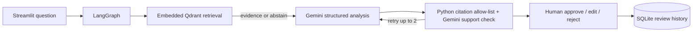

# QualityCopilot

QualityCopilot is a compact showcase of evidence-grounded analysis over 180 reproducible synthetic FMEA-style reports. A LangGraph workflow retrieves report evidence from local embedded Qdrant, uses Gemini to produce structured hypotheses and check claim support when `GEMINI_API_KEY` is configured, then allows a human to approve, edit, or reject claims with decisions saved to SQLite. Without a key, a deterministic offline demo model keeps the app and automated checks usable without API calls. It is a demo, not a real quality system.

## Run locally

```bash
python -m venv .venv
source .venv/bin/activate
pip install -r requirements.txt
python scripts/generate_data.py
python -c 'from scripts.generate_data import generate; from qualitycopilot.retrieval import ingest; ingest(generate()[0])'
streamlit run app.py
```

Configure a Gemini API key from Google AI Studio as an environment variable or in Streamlit secrets. Never commit credentials.

```dotenv
GEMINI_API_KEY = "..."
GEMINI_MODEL = "gemini-2.5-flash"
```

`GOOGLE_API_KEY` is also accepted as a compatibility alias. With no key, the app uses the deterministic demo model; when a key is set, Gemini initialization or request failures are shown as a friendly error instead of silently falling back to demo answers.

## Verification

```bash
python scripts/verify.py
python -m pytest -q
python eval/run_eval.py
```

The automated verification and retrieval evaluation are designed to run offline and do not consume Gemini tokens. To exercise live Gemini calls, configure a key, keep provider spending limits low, and submit a demo question in the app. Live provider behavior is not represented as tested merely because offline checks pass.

## Evaluation

`python eval/run_eval.py` generates known-pattern queries from `data/ground_truth.json`, measures retrieval Hit@5 and MRR, and tests off-topic retrieval abstention without LLM-written references or token usage. Run it after building the index; it writes `eval/results/latest.json`. The retrieval implementation is deterministic token-feature hashing, so this measures lexical retrieval rather than Gemini answer quality. No before/after improvement is claimed until both configurations have been run and measured.

| Configuration | Hit@5 | MRR | Abstention accuracy | Citation validity | Tokens |
|---|---:|---:|---:|---:|---:|
| Deterministic token hashing, one report per point | Run `python eval/run_eval.py` | Generated | Generated | Enforced in code | 0 |
| Before/after comparison | Not measured | Not measured | Not measured | — | — |

## Architecture



## Limitations and next steps

- The reports are synthetic and small-scale; they do not establish real manufacturing quality or safety performance.
- Hash-based retrieval is lexical and can miss semantic matches. The demo validator and live Gemini validator can both be wrong and are not proof of truth.
- Local SQLite and embedded Qdrant state can reset on ephemeral hosting. Rebuild the index at deployment/startup or use persistent storage.
- Next: benchmark embedding-based retrieval against this baseline, add independent evidence-span validation, and run a measured before/after evaluation.

## Deploy

Deploy on Streamlit Community Cloud by selecting `app.py`, adding `GEMINI_API_KEY` (and optionally `GEMINI_MODEL`) under app secrets, and using `requirements.txt`. Keep credentials outside the repository. The index is generated from the deterministic report generator when absent; local state may not persist on ephemeral hosts.
