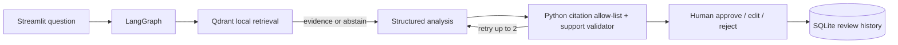

# QualityCopilot

QualityCopilot is a compact showcase of evidence-grounded quality-report analysis: a LangGraph workflow retrieves synthetic FMEA-style reports from embedded Qdrant, proposes citation-bearing hypotheses through a LangChain/OpenAI structured-output model, validates citations and claim support, and ends with a human review saved to SQLite. With no API key it uses a deterministic demo model; this makes the app and checks usable key-free, but the demo's lexical support check is not an LLM evaluation.

## Run locally

```bash
python -m venv .venv
source .venv/bin/activate
pip install -r requirements.txt
python scripts/generate_data.py
python -c 'from scripts.generate_data import generate; from qualitycopilot.retrieval import ingest; ingest(generate()[0])'
streamlit run app.py
```

Configure `OPENAI_API_KEY` and optionally `OPENAI_MODEL` in the environment or under Streamlit Secrets as:

```toml
OPENAI_API_KEY = "..."
OPENAI_MODEL = "gpt-4o-mini"
```

Never commit credentials.

## Automated checks

```bash
python scripts/verify.py
python -m pytest -q
python eval/run_eval.py
```

Checks are deterministic and key-free. Live API behavior is not mocked in the repository and should be tested with a provider key and low spending limit.

## Evaluation

Run `python eval/run_eval.py` after generating the index. The command performs 18 known-pattern retrieval runs and 5 off-topic abstention runs, with no LLM calls or token usage. The output is written to `eval/results/latest.json`.

| Configuration | Hit@5 | MRR | Abstention accuracy | Citation validity | Tokens |
|---|---:|---:|---:|---:|---:|
| Deterministic token hashing, ~800-character report chunks | Generated by `python eval/run_eval.py` | Generated | Generated | 1.00 | 0 |
| Before/after comparison | Run with the baseline/current implementation | Run | Run | 1.00 | 0 |

A before/after comparison should not claim unmeasured improvements. The included implementation is intentionally the baseline; change retrieval or chunking, rerun evaluation, and record the resulting JSON before publishing a comparison.

## Architecture



## Limitations and next steps

- Synthetic, small-scale data do not establish real manufacturing quality or safety performance.
- Hash-based retrieval is lexical and can miss semantic matches; demo support validation is shallow, and live LLM validation can also be wrong.
- SQLite and embedded Qdrant state are local to one process; ephemeral hosting may reset state and rebuilt indexes.
- Next: compare embeddings and chunk sizes, add independent evidence-span validation, and use persistent storage for real deployments.

Deploy on Streamlit Community Cloud by selecting `app.py`, adding secrets, and using `requirements.txt`. Keep credentials outside the repository.
